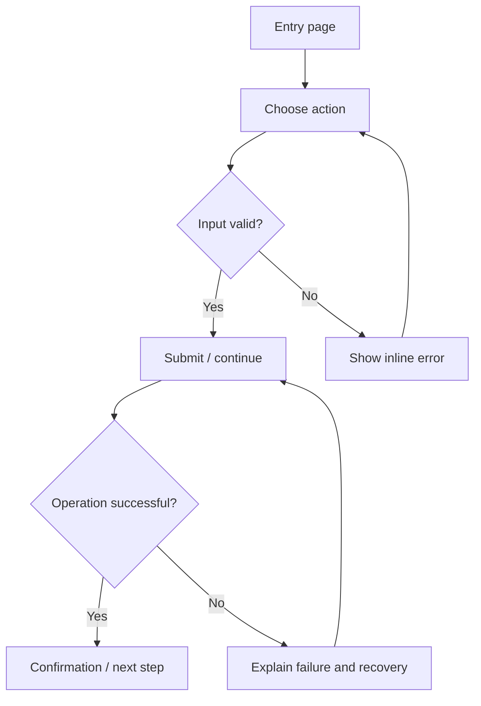

# Application Flow Document

> Copy into the client project as `docs/APP_FLOW.md`. Include a Mermaid diagram and plain-language descriptions. Every branch should lead to a defined success, retry, cancellation or error state.

## Document control
- Project / version / date: [TBD]
- Product owner / reviewer: [TBD]
- Related PRD: [TBD]

## 1. Main journeys
List each user type and the task they need to complete.
- Journey A:
- Entry point:
- Desired outcome:
- Authentication requirement:
- Success confirmation:

## 2. Primary flow diagram

Replace this example with the project's actual screens and decisions.

## 3. Screen and state inventory
| Screen / route | Purpose | Entry conditions | Main actions | Next states | Empty/error/loading behavior |
|---|---|---|---|---|---|
| [TBD] | [TBD] | [TBD] | [TBD] | [TBD] | [TBD] |

## 4. Journey specifications
For each journey document:
1. Entry point and preconditions.
2. User action and system response.
3. Validation and decision branches.
4. Data created/read/updated and authorization checks.
5. Success confirmation.
6. Recoverable errors, retries, cancellation and duplicate-submit handling.
7. Keyboard/mobile/accessibility behavior.

## 5. Roles and permissions
| Role | View | Create | Edit | Delete/export | Restrictions |
|---|---|---|---|---|---|
| [TBD] | [TBD] | [TBD] | [TBD] | [TBD] | [TBD] |

## 6. Edge cases
- Invalid or missing input:
- Network/API unavailable:
- Duplicate submission:
- Session expired / unauthorized:
- Empty results / no matching records:
- Long text, small viewport and keyboard-only navigation:
- Partial integration failure:

## 7. Flow-based acceptance tests
| Test ID | Given | When | Then | Automated/manual | Evidence |
|---|---|---|---|---|---|
| FLOW-001 | [TBD] | [TBD] | [TBD] | [TBD] | [TBD] |
