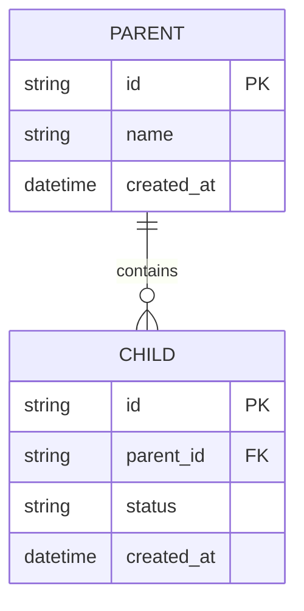

# Backend and Data Schema Document

> Copy into the client project as `docs/BACKEND_SCHEMA.md`. This is a human-readable design record. The actual schema, migrations, API contracts and generated types in source control remain authoritative.

## Document control
- Project / version / date: [TBD]
- Data owner / technical owner: [TBD]
- Status: Draft / In review / Approved
- Related TRD / architecture: [TBD]

## 1. Data architecture
- Database / storage type and version:
- Source of truth:
- Environment separation:
- Migration tooling:
- Backup/restore owner and retention:
- Data sensitivity classification:

## 2. Entity relationship diagram

Replace with the actual entities and cardinalities.

## 3. Entity/data dictionary
| Entity/table | Field | Type | Required | Constraints/index | Meaning | Sensitive? |
|---|---|---|---|---|---|---|
| [TBD] | id | UUID/CUID | Yes | PK, unique | Stable identifier | No |

For each entity document:
- Purpose and lifecycle:
- Fields, types, defaults and nullability:
- Primary/foreign keys and relation cardinality:
- Unique constraints and indexes:
- Enum/value constraints:
- Created/updated timestamps:
- Deletion behavior and referential integrity:

## 4. API and event contracts
| Name | Method/event | Input schema | Output schema | AuthZ | Failure modes |
|---|---|---|---|---|---|
| [TBD] | [TBD] | [TBD] | [TBD] | [TBD] | [TBD] |

## 5. Integrity and business rules
- Validation rules:
- Ownership/tenant boundaries:
- Duplicate prevention / idempotency:
- Transaction boundaries:
- Concurrency expectations:
- Audit trail requirements:

## 6. Privacy and security
- Personal/sensitive fields:
- Access matrix:
- Data minimization:
- Retention/deletion/export:
- Encryption in transit/at rest:
- Secret handling (names only; never paste secret values):
- Logging redaction:

## 7. Migrations and operations
- Migration history/location:
- Safe forward migration:
- Backfill strategy:
- Rollback/restore strategy:
- Backup schedule and restore-test evidence:
- Monitoring and data integrity checks:

## 8. Verification
- [ ] Schema and migration files reviewed.
- [ ] Constraints and relations validated.
- [ ] Migrations tested against disposable/local data.
- [ ] Seed/test data contains no real client or patient data.
- [ ] Backup and restore process documented.
- [ ] API authorization and validation tested.
- Evidence / approver / date: [TBD]
